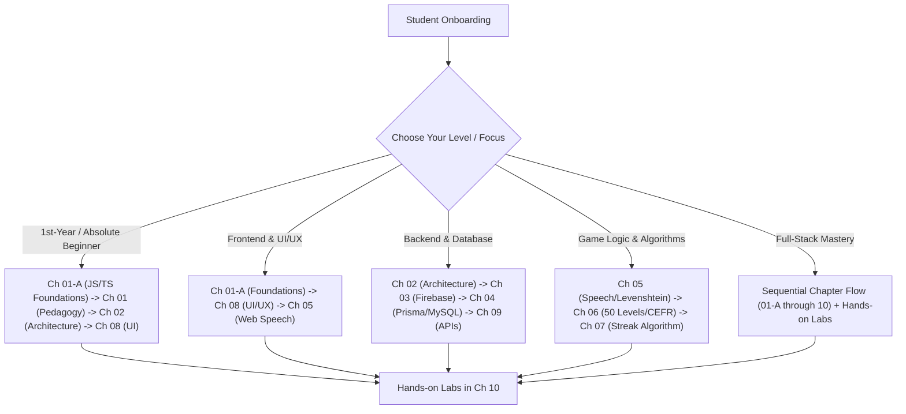

# VOICE — Technical Documentation & Student Learning Guide

> **Brand:** VOICE  
> **Tagline:** *Find Your Words. Express Yourself.*  
> **Target Audience:** First-Year Computer Science Students, Full-Stack Learners, Software Engineering Apprentices, and Language Tech Enthusiasts.

Welcome to the comprehensive, chapter-by-chapter student handbook and engineering documentation for **VOICE**. This curriculum decomposes a full-stack, speech-driven, gamified web application from first principles.

---

## 📚 Table of Contents & Chapter Breakdown

| Chapter | Document Title | Primary Topics & Technologies Covered |
| :---: | :--- | :--- |
| **00** | [Master Index & Syllabus](file:///c:/Users/naaza/OneDrive/Desktop/voice/doc/00_master_index_and_syllabus.md) | Course navigation, prerequisites, learning paths, and project structure. |
| **01-A** | [1st-Year Student Foundations (JS, TS, React, Web)](file:///c:/Users/naaza/OneDrive/Desktop/voice/doc/01A_beginner_foundations_js_ts_and_web.md) | **Start Here if you are a Beginner!** The Restaurant Analogy, JavaScript basics, TypeScript interfaces, React 19 components, async/await, and a 20-term glossary. |
| **01** | [Project Overview & Pedagogy](file:///c:/Users/naaza/OneDrive/Desktop/voice/doc/01_project_overview_and_pedagogy.md) | Problem statement, speech hesitation psychology, CEFR language framework, gamification core loop. |
| **02** | [System Architecture & Tech Stack](file:///c:/Users/naaza/OneDrive/Desktop/voice/doc/02_system_architecture_and_tech_stack.md) | Next.js 16 App Router, Turbopack, Server vs. Client boundaries, Edge middleware, End-to-End data flow. |
| **03** | [Firebase Authentication & Security](file:///c:/Users/naaza/OneDrive/Desktop/voice/doc/03_firebase_authentication_and_security.md) | Complete Firebase guide: Client vs. Admin SDK, Google OAuth, Session Cookies, security tokens, student tutorial on using Firebase. |
| **04** | [Database Design & Prisma ORM](file:///c:/Users/naaza/OneDrive/Desktop/voice/doc/04_database_design_and_prisma_orm.md) | Relational modeling with MySQL, Prisma ORM, entity relationships, migrations, indexing, and student Prisma guide. |
| **05** | [Web Speech API & Audio Engine](file:///c:/Users/naaza/OneDrive/Desktop/voice/doc/05_web_speech_api_and_audio_processing.md) | Speech Recognition (STT), Speech Synthesis (TTS), Levenshtein Distance algorithm, anti-silence pacing, student audio guide. |
| **06** | [Game Progression & CEFR Engine](file:///c:/Users/naaza/OneDrive/Desktop/voice/doc/06_game_progression_and_cefr_engine.md) | 50 progressive game levels, 5 difficulty tiers, 600 CEFR topic database, word wheel mechanics, evaluation API. |
| **07** | [Habit Formation & Streak Engine](file:///c:/Users/naaza/OneDrive/Desktop/voice/doc/07_habit_formation_and_streak_system.md) | Habit psychology, calendar day delta algorithm, timezone handling, 7-day visual tracker, milestone celebration. |
| **08** | [Frontend Engineering & UI/UX](file:///c:/Users/naaza/OneDrive/Desktop/voice/doc/08_frontend_engineering_and_ui_ux.md) | Tailwind CSS 4, Framer Motion animations, Canvas Confetti, glassmorphism, responsive tactile buttons, React 19 Contexts. |
| **09** | [API Reference & Route Handlers](file:///c:/Users/naaza/OneDrive/Desktop/voice/doc/09_api_routes_and_backend_architecture.md) | Comprehensive REST API documentation, request/response contracts, headers, error handling, validation schemas. |
| **10** | [Student Developer Handbook & Labs](file:///c:/Users/naaza/OneDrive/Desktop/voice/doc/10_student_developer_handbook_and_labs.md) | Step-by-step local setup, Firebase project configuration, MySQL setup, troubleshooting guide, 5 student coding labs. |

---

## 🎯 Learning Objectives

By studying this documentation and exploring the codebase, students will learn:

1. **Foundational Web Programming:** How JavaScript and TypeScript interact with HTML/CSS in the browser, and how `async`/`await` handles network latency.
2. **Modern Full-Stack Architecture:** How to build high-performance web applications using **Next.js 16 (App Router)** and **React 19**.
3. **Cloud Identity & Auth Engineering:** How **Firebase Authentication** integrates with a Next.js server using both client-side triggers and server-side verification with `firebase-admin` and secure HTTP-only cookies.
4. **Database Engineering with ORM:** How to design relational schemas, write data models in **Prisma**, connect to **MySQL**, and execute optimized database queries.
5. **Browser AI & Media Interfaces:** How to capture, stream, and evaluate human speech natively in the browser using the **Web Speech API** (`webkitSpeechRecognition` & `speechSynthesis`) without expensive third-party speech APIs.
6. **Applied Algorithmic Problem Solving:** How string distance algorithms (Levenshtein distance) and temporal delta checks (calendar-day streak calculations) power real-time gaming logic.
7. **Production UI/UX Patterns:** How to implement tactile micro-interactions, spring physics, confetti particles, and accessible glassmorphism with **Tailwind CSS 4** and **Framer Motion**.

---

## 🗺️ Recommended Study Paths



---

## 📁 Repository Directory Reference

```text
voice/
├── doc/                        # Detailed Chapter Documentation & Topic Datasets
│   ├── 00_master_index_and_syllabus.md
│   ├── 01A_beginner_foundations_js_ts_and_web.md    <-- 🌟 Start Here for 1st-Year Students!
│   ├── 01_project_overview_and_pedagogy.md
│   ├── 02_system_architecture_and_tech_stack.md
│   ├── 03_firebase_authentication_and_security.md
│   ├── 04_database_design_and_prisma_orm.md
│   ├── 05_web_speech_api_and_audio_processing.md
│   ├── 06_game_progression_and_cefr_engine.md
│   ├── 07_habit_formation_and_streak_system.md
│   ├── 08_frontend_engineering_and_ui_ux.md
│   ├── 09_api_routes_and_backend_architecture.md
│   ├── 10_student_developer_handbook_and_labs.md
│   └── CEFR_One_Word_Speaking_Topics_600.xlsx
├── prisma/
│   └── schema.prisma           # MySQL schema definition & Prisma Client config
├── public/                     # Static media (avatars, icons, logos, sound assets)
├── src/
│   ├── app/                    # Next.js 16 App Router pages and API route handlers
│   │   ├── api/                # Backend endpoints (auth, levels, streak, leaderboard)
│   │   ├── login/              # Login interface
│   │   ├── signup/             # Registration interface with username validation
│   │   ├── profile/            # User settings, avatar customizer, stats
│   │   ├── page.tsx            # Main application dashboard & game stage
│   │   ├── layout.tsx          # Root HTML layout with context providers
│   │   └── globals.css         # Tailwind 4 CSS styling & themes
│   ├── components/             # Modular React UI components
│   │   ├── voice/              # Core game components (GameView, Map, ChallengeModal)
│   │   ├── ui/                 # Reusable atomic UI (GlassPanel, TactileButton, Avatar)
│   │   └── streak/             # Habit tracking & celebration modals
│   ├── context/                # Client-side React State Contexts (Auth, Level, Streak)
│   ├── hooks/                  # Custom React hooks (useSpeechRecognition, useSpeechSynthesis)
│   ├── lib/                    # Server & utility functions (Firebase, Prisma, CEFR topics)
│   └── middleware.ts           # Next.js edge route protection & session guards
├── package.json                # Project dependencies and operational scripts
└── README.md                   # Quickstart guide
```

---

*Begin your journey at [Chapter 01-A: 1st-Year Student Foundations (JavaScript, TypeScript, React & Web Basics)](file:///c:/Users/naaza/OneDrive/Desktop/voice/doc/01A_beginner_foundations_js_ts_and_web.md).*
