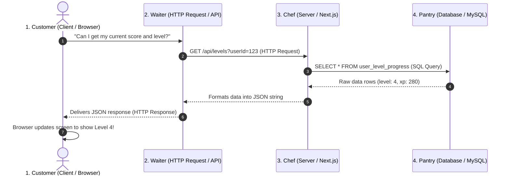

# Chapter 01-A: 1st-Year Student Foundations — JavaScript, TypeScript, React & Web Architecture

> **Navigation:** [Index](file:///c:/Users/naaza/OneDrive/Desktop/voice/doc/00_master_index_and_syllabus.md) | Next: [Chapter 01: Project Overview & Pedagogy](file:///c:/Users/naaza/OneDrive/Desktop/voice/doc/01_project_overview_and_pedagogy.md)

---

## 🎓 Welcome, 1st-Year Students!

If you are a first-year computer science, IT, or engineering student, you might feel overwhelmed when looking at modern web applications. You see words like `TypeScript`, `Next.js`, `Prisma`, `Asynchronous`, `JWT`, and `ORM`, and wonder: *"Where do I even start?"*

Don't worry! This chapter assumes **zero prior web development experience**. We will build your knowledge step-by-step from the absolute basics of how the internet works, up to the exact code patterns used in **VOICE**.

```
+-----------------------------------------------------------------------------------+
|                        THE WEB STACK EXPLAINED IN 4 PARTS                         |
+-----------------------------------------------------------------------------------+
| 1. HTML       | The Skeleton   | Gives structure to the page (headings, buttons)  |
| 2. CSS        | The Skin & Clothes| Gives styling, colors, layout, and animations |
| 3. JavaScript | The Muscles & Brain| Makes the page interactive and reactive      |
| 4. TypeScript | The Guardian Angel | Prevents programming bugs before you run code|
+-----------------------------------------------------------------------------------+
```

---

## 1. How the Web Actually Works: The Restaurant Analogy

Before writing any code, you must understand the **Client-Server Architecture**. Think of browsing the web like visiting a restaurant:



### Key Terms Explained:
* **The Client (Customer):** The device you are holding (your laptop or phone running Chrome). It displays graphics and listens to your mouse clicks, keyboard, and microphone.
* **The Server (The Kitchen / Chef):** A computer running 24/7 in a data center (or on your laptop during development). It executes business logic, verifies security, and talks to the database.
* **HTTP Request & Response (The Waiter):** The standardized messenger protocol. The client sends a *Request* (`GET`, `POST`), and the server replies with a *Response* (`200 OK`, `404 Not Found`).
* **JSON (JavaScript Object Notation):** The universal text format computers use to exchange data. It looks like a dictionary with key-value pairs:
  ```json
  {
    "username": "Alex",
    "level": 4,
    "isSpeaking": true
  }
  ```
* **The Database (The Pantry):** The permanent filing cabinet (MySQL) where data is preserved even when your laptop is turned off.

---

## 2. JavaScript (JS) — The Language of the Web

**JavaScript** is the only programming language that web browsers can execute natively. Every time a web page animates, plays audio, or updates without refreshing, JavaScript is doing the work.

### A. Variables: `const` vs `let`
In modern JavaScript, we don't use the old `var` keyword because it caused accidental bugs. We only use two keywords:

```javascript
// 1. const (Constant): The value cannot be reassigned once created.
const appName = "VOICE";
const targetDuration = 30; // seconds

// 2. let: Use this only when the value MUST change over time.
let currentScore = 0;
currentScore = currentScore + 10; // Allowed!
```

### B. Functions & Arrow Functions
A function is a reusable machine that takes inputs and returns an output:

```javascript
// Traditional Function Syntax:
function addPoints(currentScore, earned) {
  return currentScore + earned;
}

// Modern Arrow Function Syntax (Used in 99% of modern React):
const addPoints = (currentScore, earned) => {
  return currentScore + earned;
};

// If it's a one-liner, you can omit the curly braces and return keyword:
const multiplyXP = (xp, multiplier) => xp * multiplier;
```

### C. Objects and Arrays
* **Arrays** are ordered lists of items:
  ```javascript
  const stages = ["Beginner", "Elementary", "Intermediate", "Advanced", "Expert"];
  console.log(stages[0]); // Outputs: "Beginner" (0-indexed!)
  ```
* **Objects** are structured records with named fields:
  ```javascript
  const student = {
    displayName: "Sarah",
    level: 3,
    streakDays: 7,
    badges: ["First Speech", "7-Day Flame"],
  };
  console.log(student.displayName); // Outputs: "Sarah"
  ```

### D. Synchronous vs. Asynchronous Code (`async` / `await`)
This is the **#1 concept** where first-year students get confused!

* **Synchronous (Blocking):** Code runs line by line, one after another. If line 2 takes 5 seconds, the whole browser freezes for 5 seconds.
* **Asynchronous (Non-Blocking):** When doing a slow task (like fetching data over the internet or accessing the microphone), JavaScript starts the task in the background, gives you a `Promise` (like a restaurant buzzer), and keeps running other code. When the task finishes, it returns the result!

```javascript
// ❌ Old messy way: Callback hell or .then() chains
fetch("/api/levels")
  .then((response) => response.json())
  .then((data) => console.log(data));

// ✔ Modern, clean way: async / await (Reads like normal English!)
async function loadUserData() {
  console.log("1. Starting to fetch...");
  
  // The 'await' keyword pauses this function until the server answers,
  // but it DOES NOT freeze the browser UI!
  const response = await fetch("/api/levels?userId=student_1");
  const data = await response.json();
  
  console.log("2. Data received from server:", data);
  return data;
}
```

---

## 3. TypeScript (TS) — JavaScript with Superpowers

### What is TypeScript and Why Does VOICE Use It?
JavaScript is dynamically typed. This means a variable can hold a number one second, and a string the next second. While flexible, this leads to **devastating silent crashes**:

```javascript
// 🚨 REAL JAVASCRIPT DISASTER:
const user = { email: "alex@uni.edu", score: 100 };

// You make a tiny spelling mistake:
console.log(user.emai); // Notice missing 'l'!
// In JavaScript, this DOES NOT throw an error! It silently returns 'undefined'.
// If you send an email to 'undefined', your entire app crashes in production!
```

**TypeScript fixes this completely!** TypeScript adds **static types**. If you make a typo, TypeScript puts a bright red underline under your code right in your editor before you even save the file:

```typescript
// ✔ THE TYPESCRIPT WAY:
interface UserProfile {
  email: string;
  score: number;
}

const user: UserProfile = { email: "alex@uni.edu", score: 100 };

console.log(user.emai);
// ❌ COMPILE ERROR: Property 'emai' does not exist on type 'UserProfile'. 
// Did you mean 'email'?
```

### Essential TypeScript Syntax Every Student Must Know:

#### 1. Primitive Types
```typescript
const studentName: string = "Elena";
const age: number = 19;
const isEnrolled: boolean = true;
const targetWords: string[] = ["Courage", "Resilience", "Empathy"];
```

#### 2. Interfaces (The Blueprint)
An interface defines the shape an object must follow:
```typescript
interface WordChallenge {
  level: number;
  word: string;
  targetDurationSeconds: number;
  guidingQuestion: string;
  optionalHint?: string; // The '?' means this property is optional
}

const levelOne: WordChallenge = {
  level: 1,
  word: "Curiosity",
  targetDurationSeconds: 15,
  guidingQuestion: "Why is curiosity important in life?",
  // optionalHint can be omitted without any error!
};
```

#### 3. Union Types (Restricting Values to a Specific List)
Instead of allowing any random string, you can restrict a variable to exact options:
```typescript
type DifficultyStage = "Beginner" | "Elementary" | "Intermediate" | "Advanced" | "Expert";

let currentDifficulty: DifficultyStage = "Beginner"; // ✔ Valid
currentDifficulty = "SuperUltraHard"; // ❌ COMPILE ERROR! Not in the allowed list.
```

---

## 4. React 19 — The Component (LEGO) Model

In the old days of web development (2010), developers wrote massive HTML files and used `document.getElementById("btn").innerHTML = "..."`. For an app with 50 levels, popups, microphones, and audio visualizers, raw DOM code turns into an unmaintainable nightmare.

**React** revolutionized web development by breaking web pages into **Components** (like modular LEGO bricks):

```
+-----------------------------------------------------------------------------------+
|                              REACT COMPONENT TREE                                 |
+-----------------------------------------------------------------------------------+
| [VoiceApp]                                                                        |
|    ├── [VoiceHeader]                                                              |
|    │      ├── [UserAvatar avatarId="avatar-01" />]                                |
|    │      └── [StreakPill streak={7} />]                                          |
|    ├── [VoiceGameView]                                                            |
|    │      ├── [WordWheel word="Resilience" />]                                    |
|    │      └── [TactileButton onClick={startChallenge}>Start</TactileButton]       |
|    └── [ChallengeModal isOpen={true} />]                                          |
+-----------------------------------------------------------------------------------+
```

### The Three Core React Concepts:

#### 1. JSX (JavaScript XML)
JSX allows you to write HTML-like syntax directly inside your JavaScript/TypeScript code:
```tsx
function WelcomeBadge({ name }: { name: string }) {
  return (
    <div className="p-4 bg-blue-100 rounded-xl">
      <h2 className="text-xl font-bold">Welcome back, {name}! 👋</h2>
    </div>
  );
}
```

#### 2. State (`useState`) — The Component's Memory
A component needs a way to remember information that changes when a user interacts with it (e.g., whether the microphone is currently listening or not):

```tsx
import React, { useState } from "react";

export function MicrophoneButton() {
  // 1. isListening: The current value (starts as false)
  // 2. setIsListening: The setter function to change the value
  const [isListening, setIsListening] = useState(false);

  const handleClick = () => {
    // Flip true to false, or false to true
    setIsListening(!isListening);
  };

  return (
    <button 
      onClick={handleClick}
      className={isListening ? "bg-red-500 text-white" : "bg-blue-500 text-white"}
    >
      {isListening ? "🛑 Stop Recording" : "🎤 Start Recording"}
    </button>
  );
}
```
> **Magic of React:** Whenever you call `setIsListening(true)`, React **automatically re-renders** the button on the screen! You never need to write manual DOM commands.

#### 3. Effects (`useEffect`) — Doing Things on Page Load
What if you need to perform an action when the component first appears on the screen (such as preloading speech voices or fetching user data from the server)?

```tsx
import React, { useEffect, useState } from "react";

export function StudentScore() {
  const [score, setScore] = useState(0);

  // useEffect runs ONCE when the component mounts onto the screen
  useEffect(() => {
    async function fetchScore() {
      const res = await fetch("/api/levels?userId=test_student");
      const data = await res.json();
      setScore(data.unlockedLevel * 10);
    }

    fetchScore();
  }, []); // The empty array [] means "run only once on initial mount"

  return <p>Your total score: {score} XP</p>;
}
```

---

## 5. Next.js 16 — The Full-Stack Glue

If React is the engine, **Next.js** is the entire sports car:
1. **File-System Routing:** You don't configure complicated route tables.
   - A file at `src/app/page.tsx` becomes `http://localhost:3000/`.
   - A file at `src/app/login/page.tsx` becomes `http://localhost:3000/login`.
   - A file at `src/app/api/streak/route.ts` becomes a backend REST API endpoint at `http://localhost:3000/api/streak`.
2. **Server + Client in One Codebase:** You can write frontend React buttons AND backend SQL database queries in the same project without managing two separate repositories!

---

## 6. Comparison Table: Pure JavaScript vs. TypeScript in VOICE

| Scenario | Pure JavaScript (`.js`) | Modern TypeScript (`.ts`) in VOICE |
| :--- | :--- | :--- |
| **Typo in Variable** | Returns `undefined`. Fails in production. | Red underline in VS Code. Fails at compile-time. |
| **Passing Wrong Argument** | Allows passing `"ten"` to a function expecting `10`. Results in `NaN`. | Prevents build: `Argument of type 'string' is not assignable to parameter of type 'number'`. |
| **API Response Shape** | You have to guess what fields come back from the server. | Autocomplete prompts you with `.unlockedLevel`, `.completedLevels`, etc. |
| **Refactoring Code** | Renaming a field breaks 20 files silently. | Renaming a field in an interface auto-updates or flags every file in the codebase. |

---

## 7. First-Year Student Cheat Sheet & Glossary (20 Essential Terms)

1. **Client:** The web browser running on the user's computer.
2. **Server:** The remote computer that runs business logic and hosts APIs.
3. **HTTP (HyperText Transfer Protocol):** The request/response protocol of the web.
4. **REST API:** A standardized way for clients to request data from servers using URLs.
5. **JSON:** Lightweight text format for storing and exchanging data (`{"key": "value"}`).
6. **DOM (Document Object Model):** The tree of HTML elements rendered by the browser.
7. **Component:** An independent, reusable piece of user interface in React.
8. **JSX:** JavaScript XML; writing HTML syntax inside JavaScript files.
9. **State:** Private, reactive data stored inside a React component.
10. **Props:** Inputs passed into a React component from its parent.
11. **Hook:** Special functions starting with `use` (e.g., `useState`, `useEffect`) that let you hook into React features.
12. **Interface:** A TypeScript contract defining required properties and types of an object.
13. **Compile-Time vs Runtime:** Compile-time is when you write/build code; runtime is when the user runs the code.
14. **Promise:** An object representing the eventual completion or failure of an asynchronous operation.
15. **async / await:** Syntactic sugar that makes asynchronous code look and behave like synchronous code.
16. **ORM (Object-Relational Mapper):** A tool (like Prisma) to query databases using TypeScript instead of SQL strings.
17. **MySQL:** A relational database management system using tables with rows and columns.
18. **JWT (JSON Web Token):** A cryptographically signed token proving a user's identity.
19. **Cookie:** A small piece of data stored securely in the browser by a server.
20. **Web Speech API:** Browser-native interface for speech recognition and speech synthesis.

---

## 8. Student Self-Test Questions

Test your understanding before proceeding:

1. **Why does VOICE use `const` instead of `var` in modern TypeScript?**
2. **What is the difference between a Client and a Server in the Restaurant Analogy?**
3. **If you see `await fetch(...)`, what does the `await` keyword actually do?**
4. **Why is TypeScript preferred over JavaScript when writing a large, complex application?**
5. **In React, what happens to the screen when you call a state setter function like `setScore(100)`?**

---

*Now that you understand the foundational building blocks, continue to [Chapter 01: Project Overview & Pedagogy](file:///c:/Users/naaza/OneDrive/Desktop/voice/doc/01_project_overview_and_pedagogy.md) to explore the vision and educational design of VOICE!*
