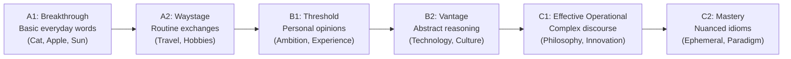

# Chapter 01: Project Overview & Pedagogy

> **Navigation:** [Index](file:///c:/Users/naaza/OneDrive/Desktop/voice/doc/00_master_index_and_syllabus.md) | Next: [Chapter 02: System Architecture & Tech Stack](file:///c:/Users/naaza/OneDrive/Desktop/voice/doc/02_system_architecture_and_tech_stack.md)

---

## 1. Executive Summary

**VOICE** (*Find Your Words. Express Yourself.*) is an interactive, gamified web application designed to help learners and speakers overcome conversational hesitation, expand their spontaneous vocabulary, and build vocal confidence.

Unlike conventional language learning apps that rely on passive multiple-choice quizzes or tapping flashcards, **VOICE** challenges learners to speak out loud under real-time constraints. By combining the **Common European Framework of Reference for Languages (CEFR)** standards with modern video game progression mechanics (stages, unlockable levels, badges, streaks, and particle physics), VOICE turns speaking practice into an engaging daily routine.

```
+-----------------------------------------------------------------------------------+
|                                     VOICE                                         |
|                       "Find Your Words. Express Yourself."                       |
+-----------------------------------------------------------------------------------+
|  [Spin & Select]  --->  [Timed Extemporaneous Speech]  --->  [Real-Time Analysis] |
|        ^                                                                  |       |
|        |                                                                  v       |
|  [Unlock Levels]  <---  [XP, Stars, Badges & Streaks]  <---  [Levenshtein Match]  |
+-----------------------------------------------------------------------------------+
```

---

## 2. The Core Problem: The Articulation Gap

In language acquisition and public communication, there is a pronounced gap between **Passive Vocabulary** and **Active Vocabulary**:

1. **Passive Vocabulary (Recognition):** Words a learner understands when reading a book or listening to someone speak. Most learners have a passive vocabulary of 10,000 to 20,000 words.
2. **Active Vocabulary (Production):** Words a learner can spontaneously retrieve and articulate while under conversational pressure. Most speakers struggle with an active vocabulary of fewer than 3,000 words.

### The Psychology of Speech Hesitation
When an individual is asked to speak spontaneously, several cognitive and psychological friction points occur simultaneously:
* **The "Tip of the Tongue" phenomenon:** Cognitive delay in neural retrieval of target lexical terms.
* **Fear of Judgment (Glossophobia):** Hesitation caused by self-monitoring and fear of grammatical imperfection.
* **Cadence Collapse:** The speaker stops speaking after 3–5 seconds due to a lack of mental structure.

### How Traditional Solutions Fail
* **Duolingo / Babbel:** Focus heavily on translation, spelling, and multiple-choice clicks. Spoken exercises are often limited to repeating isolated 3-word sentences.
* **Toastmasters / Speech Coaches:** High barrier to entry, expensive, intimidating for beginners, and not available on-demand 24/7.
* **Text Flashcards (Anki):** Great for memorizing definitions, but fail to build motor-muscle memory in the vocal tract.

---

## 3. The Pedagogical Solution: Extemporaneous Cadence Training

VOICE addresses this challenge through **Micro-Extemporaneous Speaking Drills**. The methodology operates on three evidence-based educational tenets:

### A. Constrained Prompting
Instead of asking a learner open-ended questions like *"Tell me about your life"*, VOICE prompts the user with an exact target word and a structured conversation seed (e.g., Target Word: *"Resilience"*, Guiding Question: *"Describe a moment when you refused to give up"*). This eliminates blank-slate cognitive paralysis.

### B. The Cadence Timer
Every level imposes a structured duration band (ranging from 15 seconds at Level 1 up to 60+ seconds at Expert levels). The student must maintain speaking cadence throughout the target window without long silences.

### C. The CEFR Framework Integration
VOICE aligns its vocabulary and speaking prompts with the internationally recognized **CEFR (Common European Framework of Reference for Languages)**:



The application houses a curated database of **600 CEFR Topics** (stored in `src/lib/game/cefr-topics.ts` and `doc/CEFR_One_Word_Speaking_Topics_600.xlsx`) spanning 9 real-world categories:
1. Everyday Life
2. People & Relationships
3. Emotions & Mindset
4. Education & Learning
5. Technology & Innovation
6. Nature & Environment
7. Society & Culture
8. Abstract Concepts
9. Professional & Career

---

## 4. The Core Gameplay Loop

The architecture of VOICE is built around an addictive, positive-feedback game loop:

```mermaid
sequenceDiagram
    autonumber
    actor User as Student
    participant UI as Voice Dashboard
    participant Engine as Speech Evaluator
    participant DB as Backend & Database

    User->>UI: Selects Active Level from Saga Map
    UI->>UI: Spins Word Wheel & Fetches Level Word
    UI->>User: Displays Target Word, Definition & Prompt
    User->>UI: Clicks "Start Speaking" & Grants Microphone
    loop Real-time Speech Capture
        User->>UI: Speaks extemporaneously into microphone
        UI->>UI: Live audio transcription & volume pulse
    end
    User->>UI: Hits "Finish Challenge" or Timer Expires
    UI->>Engine: Dispatches Transcript + Duration
    Engine->>Engine: Evaluates Word Count, Duration & Anti-Silence
    alt Challenge Succeeded
        Engine->>DB: POST /api/levels (Record Progress, Award XP)
        DB-->>UI: Unlocked Level + New Streak + Star Count
        UI->>User: Confetti Celebration + Star Rating + Audio Jingle
    else Challenge Needs Improvement
        UI->>User: Constructive Feedback (e.g., "Speech too brief")
    end
```



### Breakdown of the Loop Phases:
1. **Discovery (Spin the Wheel):** The student interacts with a kinetic 3D-styled spinner that selects the target vocabulary challenge.
2. **Priming:** The student listens to the authentic native pronunciation of the word (powered by the Speech Synthesis Engine) and reviews contextual usage tips.
3. **Execution (The Cadence Run):** The student articulates their answer while visual audio waves react to their voice.
4. **Evaluation:** The evaluator examines:
   - Was speech actually detected? (Prevents silent submissions)
   - Did the user meet the minimum word threshold? (e.g., at least 4–15 words depending on difficulty)
   - Did the user speak for at least 65% of the target duration window?
5. **Progression:** The backend records the completion in MySQL via Prisma, advances the user's sequential level lock, awards experience points (XP), updates the daily streak, and unlocks badges.

---

## 5. Gamification Mechanics & Player Psychology

VOICE uses game design principles to maintain student retention:

| Mechanic | Implementation in VOICE | Psychological Purpose |
| :--- | :--- | :--- |
| **Saga World Map** | 50 sequential nodes organized across 5 visual biomes. | Clear sense of long-term progress and mastery. |
| **Level Gates** | Sequential locking (Level $N+1$ unlocks only upon completing Level $N$). | Prevents cognitive overwhelm; enforces curriculum order. |
| **Daily Streak Engine** | Tracks consecutive days practiced with milestone flames ($3d, 7d, 14d, 30d, 100d$). | Leverages loss aversion; turns practice into an automatic habit. |
| **Dynamic Avatars** | Unlockable visual identities stored in MySQL (`avatar_id`). | Self-expression and digital representation. |
| **Sensory Rewards** | Haptic-style button depression, confetti burst (`canvas-confetti`), sound chimes. | Immediate dopamine feedback on vocal success. |
| **Scholar Badges** | Achievements like *"Golden Book"*, *"Phoneme Pioneer"*, *"Vocal Master"*. | Milestones that reward both consistency and accuracy. |

---

## 6. Student Study Questions & Reflection

1. **Why is speaking practice harder to automate than reading or listening comprehension?**
2. **What are the technical and cognitive risks of giving a learner an open-ended topic versus a single-word prompt?**
3. **How does the CEFR framework help ensure that a beginner student is not given an overly complex topic like "Epistemology" on Level 1?**
4. **How do game mechanics like streaks and progressive unlocking alter a student's intrinsic versus extrinsic motivation?**

---

*Continue to [Chapter 02: System Architecture & Tech Stack](file:///c:/Users/naaza/OneDrive/Desktop/voice/doc/02_system_architecture_and_tech_stack.md) to explore the system diagrams and Next.js 16 full-stack architecture.*
