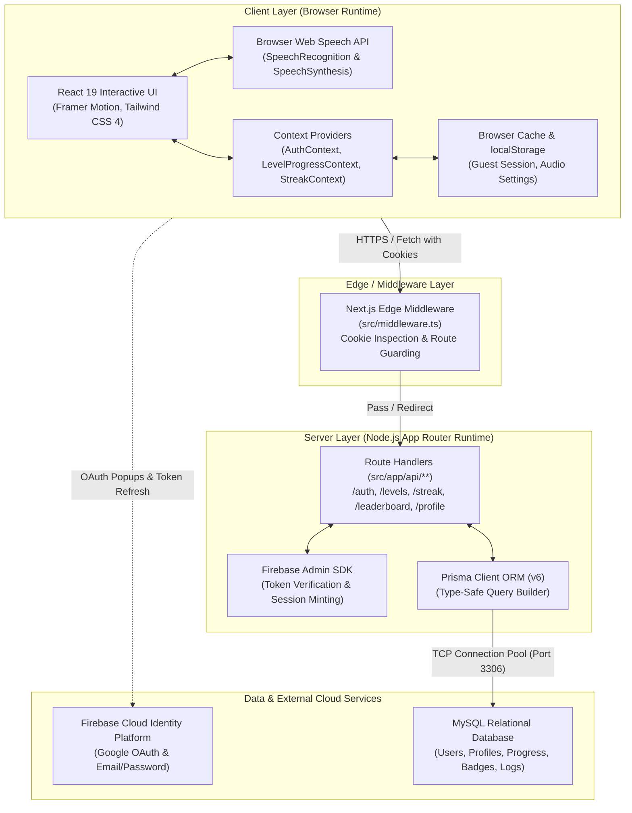
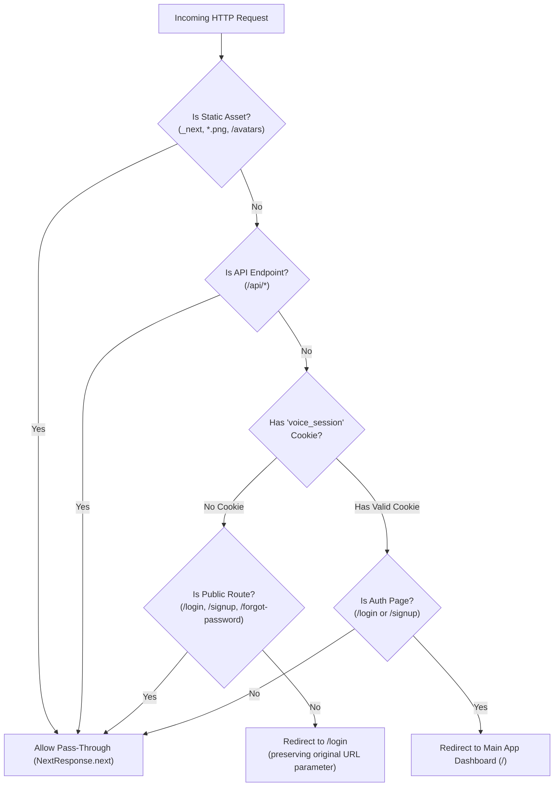
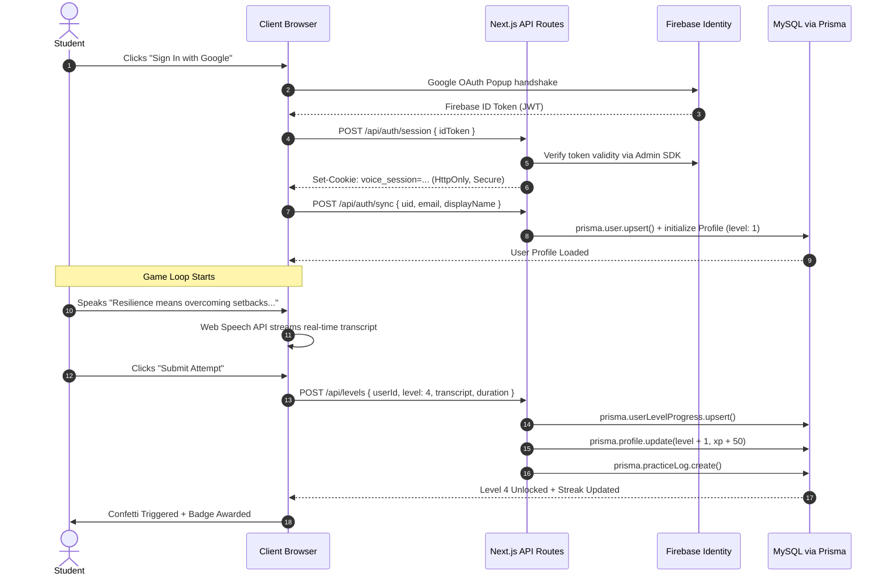

# Chapter 02: System Architecture & Tech Stack

> **Navigation:** [Index](file:///c:/Users/naaza/OneDrive/Desktop/voice/doc/00_master_index_and_syllabus.md) | Previous: [Chapter 01](file:///c:/Users/naaza/OneDrive/Desktop/voice/doc/01_project_overview_and_pedagogy.md) | Next: [Chapter 03: Firebase Authentication & Security](file:///c:/Users/naaza/OneDrive/Desktop/voice/doc/03_firebase_authentication_and_security.md)

---

## 1. High-Level Architectural Topology

**VOICE** is engineered as a modern, unified full-stack application utilizing the **Next.js 16 App Router** architecture. It merges client-side real-time media processing with server-side relational transactions and enterprise identity services.



---

## 2. Technology Stack Breakdown

| Technology Tier | Tool / Library | Version | Engineering Role in VOICE |
| :--- | :--- | :--- | :--- |
| **Framework** | Next.js (App Router) | `16.4.5` | Unified React framework for server/client components, API routing, and SSR. |
| **View Library** | React & React-DOM | `19.3.0` | Next-generation reactive UI engine utilizing concurrent features and modern hooks. |
| **Styling** | Tailwind CSS | `^4.0.0` | Utility-first styling with modern CSS variables, fluid glassmorphism, and responsive grids. |
| **Animations** | Framer Motion | `^14.10.1` | Hardware-accelerated UI spring physics, modal transitions, and kinetic map animations. |
| **Visual Effects** | Canvas Confetti | `^1.9.4` | Canvas particle explosion engine for celebrating level completions and streak gains. |
| **Icons** | Lucide React | `^1.70.0` | Lightweight, customizable SVG iconography. |
| **Auth (Client)** | Firebase Client SDK | `^13.4.0` | Client-side OAuth authentication, email/password handling, and JWT token retrieval. |
| **Auth (Server)** | Firebase Admin SDK | `^14.5.1` | Server-side JWT signature verification and cryptographic session cookie creation. |
| **ORM** | Prisma ORM | `^6.19.3` | Type-safe schema definition, automated migrations, and SQL query builder. |
| **Database** | MySQL | `8.x` | Production-grade relational database storing user profiles, gamification stats, and logs. |
| **Speech STT/TTS**| Web Speech API | W3C Standard | Native browser APIs for real-time speech-to-text recognition and text-to-speech synthesis. |

---

## 3. Server Components vs. Client Components Boundary

In Next.js 16 App Router, all components are **Server Components by default** unless designated with the `"use client"` directive. Understanding this division is essential for full-stack students.

```
+-----------------------------------------------------------------------------------------+
|                                    RENDER BOUNDARY                                      |
+-----------------------------------------------------------------------------------------+
| SERVER COMPONENTS (Node.js Runtime)           | CLIENT COMPONENTS (Browser DOM Runtime) |
| - src/app/layout.tsx                          | - src/components/voice/VoiceGameView.tsx|
| - src/app/api/**/route.ts (Route Handlers)    | - src/components/voice/ChallengeModal.tsx|
| - src/lib/firebase/admin.ts                   | - src/components/voice/VoiceMap.tsx     |
| - src/lib/prisma.ts                           | - src/context/AuthContext.tsx           |
|                                               | - src/hooks/useSpeechRecognition.ts     |
| Capabilities:                                 | Capabilities:                           |
| ✔ Access server env (FIREBASE_PRIVATE_KEY)   | ✔ Access browser APIs (navigator, window)|
| ✔ Connect directly to MySQL database         | ✔ Access Web Speech API (Microphone/TTS)|
| ✔ Verify JWT tokens cryptographically         | ✔ Listen to onClick, onChange, keystroke|
| ❌ Cannot access window, navigator, or mic    | ✔ Manage useState, useEffect, useRef    |
+-----------------------------------------------------------------------------------------+
```

### Why VOICE Segregates These Components:
1. **Security:** The database connection strings and Firebase Admin private keys never leak to the client bundle.
2. **Device Hardware Access:** The microphone (`navigator.mediaDevices`), audio synthesis (`window.speechSynthesis`), and speech recognition (`window.webkitSpeechRecognition`) only exist within the browser window. Components managing these interfaces must be declared with `"use client"`.

---

## 4. Edge Middleware Architecture (`src/middleware.ts`)

The Next.js Edge Middleware intercepts incoming HTTP requests **before** they reach any page or route handler. This provides millisecond-level routing control and protection.



### Code Implementation Highlights:
```typescript
// From src/middleware.ts
export function middleware(request: NextRequest) {
  const { pathname } = request.nextUrl;

  // 1. Bypass static assets and Next.js internal files
  if (ALWAYS_ALLOW.some((p) => pathname.startsWith(p))) {
    return NextResponse.next();
  }

  // 2. Allow API routes through (they handle their own auth payloads)
  if (pathname.startsWith("/api/")) {
    return NextResponse.next();
  }

  // 3. Inspect the session cookie
  const sessionCookie = request.cookies.get("voice_session")?.value;
  const isPublicPath = PUBLIC_PATHS.includes(pathname);

  // 4. Guard protected routes
  if (!sessionCookie && !isPublicPath) {
    const loginUrl = new URL("/login", request.url);
    loginUrl.searchParams.set("from", pathname);
    return NextResponse.redirect(loginUrl);
  }

  // 5. Prevent logged-in users from visiting login/signup again
  if (sessionCookie && AUTH_PAGES.includes(pathname)) {
    return NextResponse.redirect(new URL("/", request.url));
  }

  return NextResponse.next();
}
```

---

## 5. End-to-End Data Flow

Let's trace what happens when a student signs in with Google, starts Level 4, and speaks their sentence:



---

## 6. How Students Can Architect Similar Projects

When designing a modern web application, follow this decision matrix:

1. **When to use Client-Side state (React Context):** Use for ephemeral UI states, such as whether a modal is open, current microphone listening status, or real-time audio volume levels.
2. **When to use Server-Side state (Prisma + Database):** Use for all authoritative business data: user credentials, game levels unlocked, earned badges, and historical practice logs.
3. **When to use Edge Middleware:** Use for lightning-fast redirect logic and protecting routes before heavy server components or databases are initialized.
4. **Environment Variables Strategy:**
   - Prefix with `NEXT_PUBLIC_` **only** if the browser needs the value (e.g., `NEXT_PUBLIC_FIREBASE_API_KEY`).
   - Omit the prefix for secrets that must remain confidential on the server (e.g., `FIREBASE_PRIVATE_KEY`, `DATABASE_URL`).

---

## 7. Architecture Review Questions for Students

1. **What would happen if `FIREBASE_PRIVATE_KEY` were prefixed with `NEXT_PUBLIC_`?**
2. **Why does the Edge middleware bypass routes starting with `/api/` instead of blocking them if no cookie is present?**
3. **Explain the difference between execution on the Edge runtime versus the standard Node.js runtime in Next.js.**
4. **Why is it advantageous to store game progress in a relational database like MySQL rather than keeping it solely in browser `localStorage`?**

---

*Continue to [Chapter 03: Firebase Authentication & Security](file:///c:/Users/naaza/OneDrive/Desktop/voice/doc/03_firebase_authentication_and_security.md) for a deep dive into Firebase identity, session cookies, and security.*
