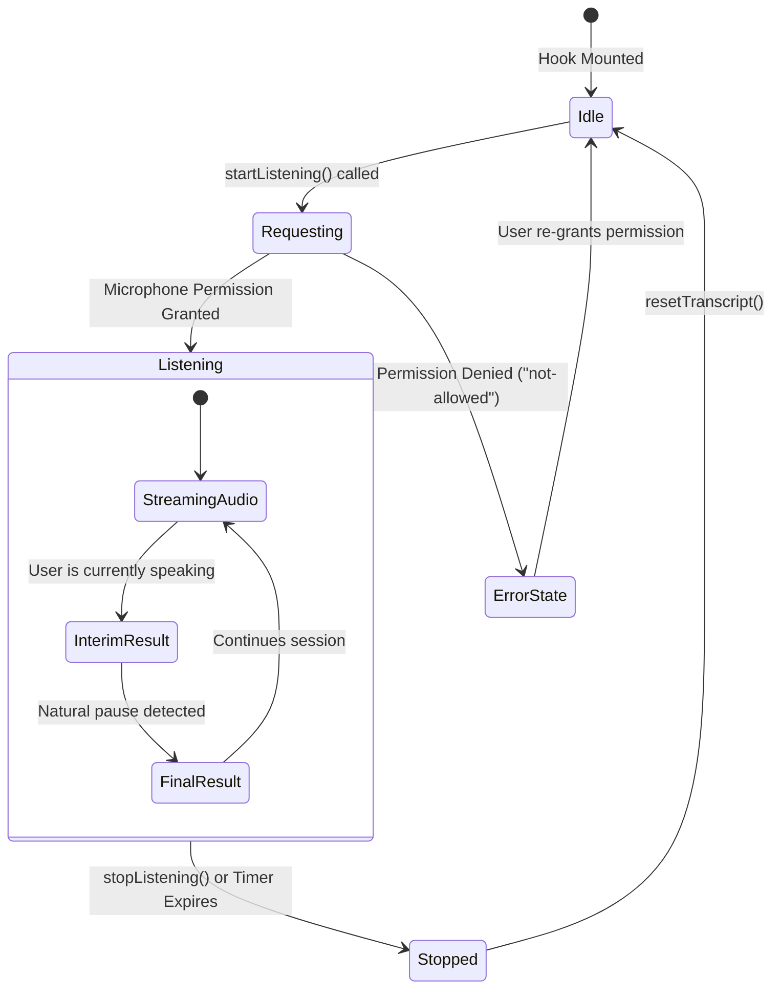
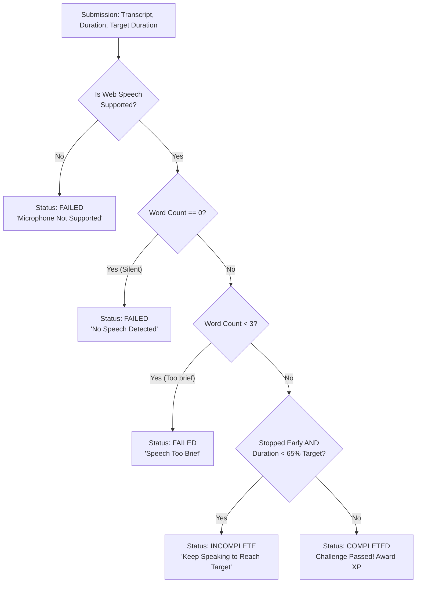

# Chapter 05: Web Speech API & Audio Processing

> **Navigation:** [Index](file:///c:/Users/naaza/OneDrive/Desktop/voice/doc/00_master_index_and_syllabus.md) | Previous: [Chapter 04](file:///c:/Users/naaza/OneDrive/Desktop/voice/doc/04_database_design_and_prisma_orm.md) | Next: [Chapter 06: Game Progression & CEFR Engine](file:///c:/Users/naaza/OneDrive/Desktop/voice/doc/06_game_progression_and_cefr_engine.md)

---

## 1. Introduction: The Web Speech API

The **Web Speech API** is an official W3C web standard that enables browsers to handle voice data natively. It is partitioned into two distinct interfaces:
1. **SpeechRecognition (Speech-to-Text / STT):** Captures incoming audio from the client's microphone, translates acoustic phonemes into text, and emits real-time transcription events.
2. **SpeechSynthesis (Text-to-Speech / TTS):** Synthesizes written text strings into spoken voice output using the operating system's installed vocal engines.

```
+-----------------------------------------------------------------------------------------+
|                                  THE WEB SPEECH API                                     |
+-----------------------------------------------------------------------------------------+
|  SPEECH RECOGNITION (Input / STT)             |  SPEECH SYNTHESIS (Output / TTS)        |
|  - Listens to device microphone               |  - Reads text aloud to the speaker      |
|  - Streams interim & final results            |  - Supports accents (en-US, en-GB, etc.)|
|  - Real-time speech transcription             |  - Adjusts rate, pitch, and volume      |
|  - Event-driven (onstart, onresult, onerror)  |  - Powered by OS speech synthesizer     |
+-----------------------------------------------------------------------------------------+
```

### Why Use Native Web Speech Over Cloud APIs?
| Metric | Native Web Speech API (VOICE) | Third-Party Cloud Speech (Whisper/Google STT) |
| :--- | :--- | :--- |
| **Cost** | **$0.00 (Completely Free)** | Costs per audio minute ($0.006 - $0.024/min). |
| **Latency** | **< 100ms (Immediate streaming)** | 1,000ms – 3,000ms (Network transit + inference). |
| **Privacy** | Audio processed locally or via browser vendor. | Audio recordings must be uploaded to external servers. |
| **Setup** | Zero API keys, zero backend pipelines. | Requires credit card, IAM keys, and bucket storage. |

---

## 2. Speech Recognition Engine (`src/hooks/useSpeechRecognition.ts`)

The speech recognition hook handles microphone initialization, permission boundaries, continuous streaming, and transcript accumulation.



### Code Implementation Deep-Dive
```typescript
// From src/hooks/useSpeechRecognition.ts
export function useSpeechRecognition() {
  const [isListening, setIsListening] = useState(false);
  const [transcript, setTranscript] = useState("");
  const [isSupported, setIsSupported] = useState(false);

  const recognitionRef = useRef<any>(null);
  const accumulatedTranscriptRef = useRef("");

  useEffect(() => {
    if (typeof window === "undefined") return;

    // Vendor prefix fallback for WebKit browsers (Safari, Chrome)
    const SpeechRecognition =
      (window as any).SpeechRecognition ||
      (window as any).webkitSpeechRecognition;

    if (!SpeechRecognition) return;

    setIsSupported(true);
    const recognition = new SpeechRecognition();
    recognition.continuous = true;      // Keep listening even if user pauses
    recognition.interimResults = true;  // Emit words before sentence is finished
    recognition.lang = "en-US";

    recognition.onresult = (event: any) => {
      let currentSessionFinal = "";
      let currentSessionInterim = "";

      for (let i = 0; i < event.results.length; i++) {
        const res = event.results[i];
        if (res && res[0]) {
          if (res.isFinal) {
            currentSessionFinal += res[0].transcript + " ";
          } else {
            currentSessionInterim += res[0].transcript + " ";
          }
        }
      }

      // Combine previous segments with current active segment
      const combined = [
        accumulatedTranscriptRef.current,
        currentSessionFinal,
        currentSessionInterim,
      ]
        .join(" ")
        .replace(/\s+/g, " ")
        .trim();

      setTranscript(combined);
    };

    recognition.onerror = (event: any) => {
      // Filter out benign events so speech isn't interrupted
      if (event?.error === "no-speech" || event?.error === "aborted") return;
      if (event?.error === "not-allowed") setIsListening(false);
    };

    recognitionRef.current = recognition;
  }, []);

  // Return reactive controls
  return { isListening, transcript, isSupported, startListening, stopListening, resetTranscript };
}
```

---

## 3. Speech Synthesis Engine (`src/hooks/useSpeechSynthesis.ts`)

The speech synthesis hook provides audible pronunciations of target vocabulary words.

### Solving Chrome's Notorious SpeechSynthesis Bugs:
1. **Garbage Collection Bug:** In Google Chrome, long speech utterances are frequently stopped halfway through because the browser's JavaScript garbage collector deletes the `SpeechSynthesisUtterance` instance.  
   *VOICE Solution:* Store the active utterance in a persistent `activeUtteranceRef.current` until the `onend` event fires.
2. **Voice Loading Delay:** Browsers load voice packs asynchronously. Calling `getVoices()` immediately on page mount returns an empty array.  
   *VOICE Solution:* Register an event listener for `voiceschanged` to populate voices dynamically.

```typescript
// From src/hooks/useSpeechSynthesis.ts
export function useSpeechSynthesis() {
  const activeUtteranceRef = useRef<SpeechSynthesisUtterance | null>(null);

  const speak = useCallback((text: string, rate: number = 1.0, lang: string = "en-US") => {
    if (typeof window === "undefined" || !("speechSynthesis" in window)) return;

    window.speechSynthesis.cancel(); // Stop any pending speech

    const utterance = new SpeechSynthesisUtterance(text);
    utterance.rate = rate; // 0.8x for learners, 1.0x normal
    utterance.lang = lang;

    // Pick the best available native voice
    const voices = window.speechSynthesis.getVoices();
    const matchedVoice = voices.find((v) => v.lang.replace("_", "-").toLowerCase() === lang.toLowerCase());
    if (matchedVoice) utterance.voice = matchedVoice;

    // Prevent garbage collection
    activeUtteranceRef.current = utterance;
    utterance.onend = () => { activeUtteranceRef.current = null; };

    window.speechSynthesis.speak(utterance);
  }, []);

  return { speak, stop: () => window.speechSynthesis.cancel() };
}
```

---

## 4. The Levenshtein Distance Accuracy Algorithm

To calculate how accurately a student articulated a target word or phrase, VOICE implements the **Levenshtein Distance Algorithm** (minimum edit distance).

### Mathematical Definition:
The Levenshtein distance between two strings $a$ and $b$ (of lengths $|a|$ and $|b|$) is given by $lev(a, b)$:

$$\text{lev}_{a,b}(i, j) = \begin{cases} 
\max(i, j) & \text{if } \min(i, j) = 0, \\
\min \begin{cases} 
\text{lev}_{a,b}(i-1, j) + 1 \\
\text{lev}_{a,b}(i, j-1) + 1 \\
\text{lev}_{a,b}(i-1, j-1) + \mathbf{1}_{(a_i \neq b_j)} 
\end{cases} & \text{otherwise.}
\end{cases}$$

### TypeScript Implementation:
```typescript
// From src/hooks/useSpeechRecognition.ts
export function calculateAccuracy(target: string, spoken: string): number {
  const s1 = target.toLowerCase().trim();
  const s2 = spoken.toLowerCase().trim();
  if (s1 === s2) return 100;
  if (!s1 || !s2) return 0;

  const track = Array(s2.length + 1)
    .fill(null)
    .map(() => Array(s1.length + 1).fill(null));

  for (let i = 0; i <= s1.length; i += 1) track[0][i] = i;
  for (let j = 0; j <= s2.length; j += 1) track[j][0] = j;

  for (let j = 1; j <= s2.length; j += 1) {
    for (let i = 1; i <= s1.length; i += 1) {
      const indicator = s1[i - 1] === s2[j - 1] ? 0 : 1;
      track[j][i] = Math.min(
        track[j][i - 1] + 1,       // Deletion
        track[j - 1][i] + 1,       // Insertion
        track[j - 1][i - 1] + indicator // Substitution
      );
    }
  }

  const distance = track[s2.length][s1.length];
  const maxLen = Math.max(s1.length, s2.length);
  return Math.max(0, Math.round(((maxLen - distance) / maxLen) * 100));
}
```

---

## 5. The Challenge Evaluator & Anti-Silence Rules (`src/lib/game/game-evaluator.ts`)

A key failure of naive voice apps is allowing users to game the system by remaining silent or murmuring a single syllable to win a badge. VOICE prevents this using **Cadence Rules**:



---

## 6. How Students Can Build Voice Apps in Their Own Projects

Students can create voice-enabled interfaces in just 40 lines of clean React code.

### Student Starter Template (Speech Recognition in React)
```tsx
import React, { useState, useEffect, useRef } from "react";

export default function StudentSpeechDemo() {
  const [text, setText] = useState("");
  const [listening, setListening] = useState(false);
  const recognitionRef = useRef<any>(null);

  useEffect(() => {
    const SpeechRecognition =
      (window as any).SpeechRecognition || (window as any).webkitSpeechRecognition;

    if (!SpeechRecognition) {
      alert("Your browser does not support the Web Speech API. Try Chrome!");
      return;
    }

    const reco = new SpeechRecognition();
    reco.continuous = true;
    reco.interimResults = true;
    reco.lang = "en-US";

    reco.onresult = (event: any) => {
      let fullText = "";
      for (let i = 0; i < event.results.length; i++) {
        fullText += event.results[i][0].transcript + " ";
      }
      setText(fullText);
    };

    recognitionRef.current = reco;
  }, []);

  const toggleListen = () => {
    if (listening) {
      recognitionRef.current.stop();
      setListening(false);
    } else {
      setText("");
      recognitionRef.current.start();
      setListening(true);
    }
  };

  return (
    <div style={{ padding: "2rem", fontFamily: "sans-serif" }}>
      <h3>🎙️ Live Web Speech Transcription Demo</h3>
      <button onClick={toggleListen}>
        {listening ? "🛑 Stop Listening" : "🎤 Start Speaking"}
      </button>
      <div style={{ marginTop: "1rem", padding: "1rem", background: "#f0f0f0", minHeight: "100px" }}>
        {text || <em>Your spoken words will appear here in real-time...</em>}
      </div>
    </div>
  );
}
```

---

## 7. Student Practice Labs

1. **Lab 5.1:** Enhance `useSpeechSynthesis` with an interactive slider that alters the speech pitch from $0.5$ (deep voice) to $2.0$ (high-pitched voice).
2. **Lab 5.2:** Add visual audio volume reactive pulsing using the browser's `AudioContext` and `AnalyserNode`.
3. **Lab 5.3:** Modify `calculateAccuracy` to perform phonetic comparison using Double Metaphone or Soundex algorithms rather than raw character distance.

---

*Continue to [Chapter 06: Game Progression & CEFR Engine](file:///c:/Users/naaza/OneDrive/Desktop/voice/doc/06_game_progression_and_cefr_engine.md) to explore the 50-level system and 600 CEFR topic database.*
