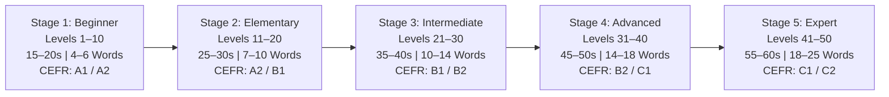
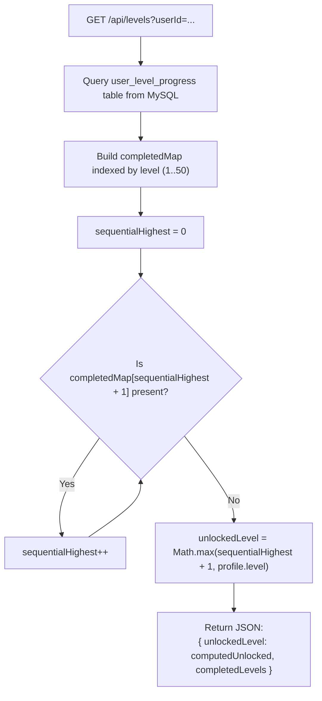

# Chapter 06: Game Progression & CEFR Engine

> **Navigation:** [Index](file:///c:/Users/naaza/OneDrive/Desktop/voice/doc/00_master_index_and_syllabus.md) | Previous: [Chapter 05](file:///c:/Users/naaza/OneDrive/Desktop/voice/doc/05_web_speech_api_and_audio_processing.md) | Next: [Chapter 07: Habit Formation & Streak Engine](file:///c:/Users/naaza/OneDrive/Desktop/voice/doc/07_habit_formation_and_streak_system.md)

---

## 1. Pedagogical Game Progression: The 50-Level Journey

A common design flaw in educational software is the "Blank Slate Paralysis" where users are overwhelmed by too many options. **VOICE** solves this through a strictly gated **50-Level Progressive Road**.

The journey is divided into **Five Difficulty Stages**, each mapping directly to the Common European Framework of Reference for Languages (CEFR):



### Stage Breakdown Matrix (`src/lib/game/game-words.ts`):
| Stage Name | Level Range | Target Duration | Min. Word Threshold | CEFR Tier | Vocabulary Focus |
| :--- | :--- | :--- | :--- | :--- | :--- |
| **Beginner** | Levels 1–10 | 15s – 20s | 4 – 6 words | A1 / A2 | Daily routines, family, basic food, weather, hobbies. |
| **Elementary** | Levels 11–20 | 25s – 30s | 7 – 10 words | A2 / B1 | Travel experiences, personal opinions, work tasks, education. |
| **Intermediate** | Levels 21–30 | 35s – 40s | 10 – 14 words | B1 / B2 | Technology, health, emotional balance, social problems. |
| **Advanced** | Levels 31–40 | 45s – 50s | 14 – 18 words | B2 / C1 | Ethics, environmental sustainability, artificial intelligence, economics. |
| **Expert** | Levels 41–50 | 55s – 60s | 18 – 25 words | C1 / C2 | Epistemology, abstract philosophical paradoxes, rhetoric, nuance. |

---

## 2. The 600 CEFR Topic Database (`src/lib/game/cefr-topics.ts`)

At the heart of VOICE is a curated, 600-topic educational dataset structured across nine broad semantic domains:

```
[Everyday Life]        [People & Relationships]   [Emotions & Mindset]
[Education & Skills]   [Technology & Modern Life] [Nature & Ecology]
[Society & Culture]    [Abstract Concepts]        [Professional Topics]
```

### Schema of a CEFR Topic Item:
```typescript
export interface CEFRTopic {
  no: number;                  // 1 to 600
  word: string;                // e.g., "Resilience"
  level: "A1" | "A2" | "B1" | "B2" | "C1" | "C2";
  tier: "Beginner" | "Elementary" | "Intermediate" | "Advanced" | "Expert";
  category: string;            // e.g., "Emotions & Mindset"
  whatToDiscuss: string;       // Context overview
  guidingQuestions: string;    // Prompting questions
  questions: string[];         // Tokenized array of questions
  meaning?: string;            // Lexical definition
  exampleChallenge?: string;   // Model sentence
}
```

### Example Entry:
```json
{
  "no": 142,
  "word": "Perseverance",
  "level": "B2",
  "tier": "Intermediate",
  "category": "Emotions & Mindset",
  "meaning": "Continued effort to do or achieve something despite difficulties or opposition.",
  "whatToDiscuss": "Overcoming obstacles through sustained dedication.",
  "guidingQuestions": "Why is perseverance vital for personal mastery? Describe a time you persevered against the odds."
}
```

---

## 3. Server-Enforced Sequential Gating (`src/app/api/levels/route.ts`)

A critical requirement in game architecture is preventing users from spoofing progress (e.g., claiming they beat Level 50 while only having played Level 1).

VOICE enforces **Server-Side Sequential Calculation**:



### Implementation Code:
```typescript
// From src/app/api/levels/route.ts
// Calculate sequential unlocked level (1 to 50)
let sequentialHighest = 0;
while (completedMap[sequentialHighest + 1]) {
  sequentialHighest++;
}

// Ensure brand new users always start at level 1
const profileLevel = user.profile?.level || 1;
const computedUnlocked = Math.min(
  TOTAL_GAME_LEVELS,
  Math.max(sequentialHighest + 1, profileLevel)
);

return NextResponse.json({
  success: true,
  unlockedLevel: computedUnlocked,
  completedLevels: completedMap,
  totalLevels: TOTAL_GAME_LEVELS,
  isGameCompleted: Boolean(completedMap[TOTAL_GAME_LEVELS]),
});
```

---

## 4. The Verification & Anti-Cheat Engine (`/api/levels/verify`)

When an attempt is submitted, the backend verifies that the client didn't bypass the timing mechanisms:

```typescript
// From src/app/api/levels/verify/route.ts
export async function POST(req: Request) {
  const { level, durationSeconds, transcript, targetDuration } = await req.json();

  const words = (transcript || "").trim().split(/\s+/).filter(Boolean);
  const wordCount = words.length;

  // Anti-cheat verification checks:
  // 1. Did the user articulate at least 3 words?
  if (wordCount < 3) {
    return NextResponse.json({ valid: false, reason: "Insufficient words spoken." }, { status: 400 });
  }

  // 2. Minimum duration requirement (at least 50% of the target time band)
  const minRequiredDuration = Math.round((targetDuration || 20) * 0.5);
  if (durationSeconds < minRequiredDuration) {
    return NextResponse.json({ valid: false, reason: "Attempt stopped too early." }, { status: 400 });
  }

  return NextResponse.json({ valid: true, wordCount, durationSeconds });
}
```

---

## 5. Scoring & Reward Calculations

When a student successfully finishes a level, the application calculates three reward metrics:

### 1. Star Rating (1 to 3 Stars)
$$\text{Stars} = \begin{cases} 
3 & \text{if } \text{wordCount} \ge \text{minWords} \times 1.5 \text{ and } \text{duration} \ge \text{targetDuration} \\
2 & \text{if } \text{wordCount} \ge \text{minWords} \text{ and } \text{duration} \ge \text{targetDuration} \times 0.75 \\
1 & \text{otherwise (bare minimum pass)}
\end{cases}$$

### 2. Experience Points (XP)
$$\text{XP Earned} = (\text{Level Number} \times 10) + (\text{Stars} \times 15)$$
* Level 1 with 3 Stars: $(1 \times 10) + (3 \times 15) = 55\text{ XP}$
* Level 40 with 3 Stars: $(40 \times 10) + (3 \times 15) = 445\text{ XP}$

### 3. Words Mastered Counter
Each completed level increments the student's cumulative `wordsMastered` count in their database profile.

---

## 6. How Students Can Use Progression Systems in Their Apps

Whether building a coding tutor, a typing trainer, or a math game, students can adopt this progression model:

```typescript
// Generic Stage Configuration Pattern
export interface QuestNode {
  id: number;
  title: string;
  minScoreToUnlockNext: number;
  challengePayload: any;
}

export function calculateUnlockedNode(completedQuestIds: Set<number>): number {
  let current = 1;
  while (completedQuestIds.has(current)) {
    current++;
  }
  return current;
}
```

---

## 7. Student Practice Labs

1. **Lab 6.1:** Add a new difficulty stage called *"Master"* spanning Levels 51–60 with a 90-second duration and 35-word threshold.
2. **Lab 6.2:** Implement an adaptive difficulty algorithm that suggests reviewing previous levels if a student scores only 1 star on three consecutive attempts.
3. **Lab 6.3:** Write a script that imports custom vocabulary lists from a CSV file into `cefr-topics.ts`.

---

*Continue to [Chapter 07: Habit Formation & Streak Engine](file:///c:/Users/naaza/OneDrive/Desktop/voice/doc/07_habit_formation_and_streak_system.md) to explore the calendar day delta algorithms that power daily streaks.*
