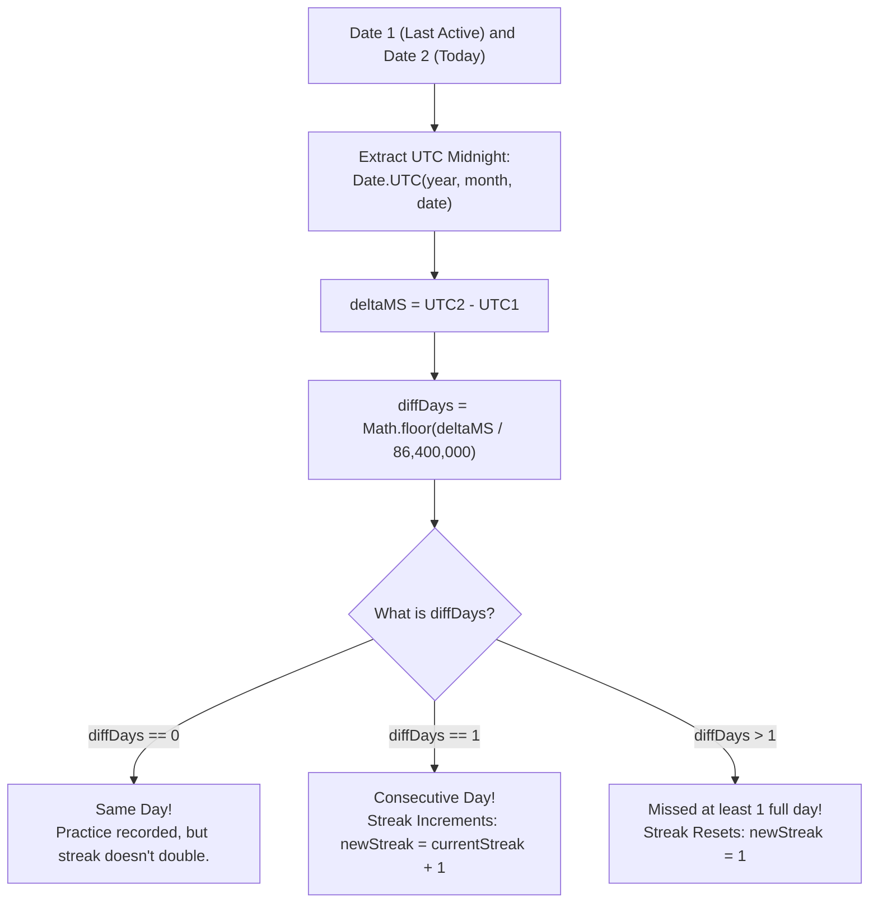

# Chapter 07: Habit Formation & Streak Engine

> **Navigation:** [Index](file:///c:/Users/naaza/OneDrive/Desktop/voice/doc/00_master_index_and_syllabus.md) | Previous: [Chapter 06](file:///c:/Users/naaza/OneDrive/Desktop/voice/doc/06_game_progression_and_cefr_engine.md) | Next: [Chapter 08: Frontend Engineering & UI/UX](file:///c:/Users/naaza/OneDrive/Desktop/voice/doc/08_frontend_engineering_and_ui_ux.md)

---

## 1. The Psychology of Daily Streaks

In modern product design, the **Daily Streak** is one of the most effective behavioral hooks for long-term user retention (utilized by GitHub, Duolingo, and Snapchat). It is rooted in two behavioral psychology principles:

1. **Loss Aversion:** The psychological pain of losing an existing 14-day streak is twice as powerful as the pleasure of starting a new one. Users will actively open the app and practice for 2 minutes to protect their streak.
2. **Identity Reinforcement:** Breaking a streak feels like breaking a personal promise. Maintaining the streak reinforces the belief: *"I am an articulate daily speaker."*

```
+-----------------------------------------------------------------------------------+
|                            THE HABIT LOOP IN VOICE                                |
+-----------------------------------------------------------------------------------+
|  1. CUE: Notification or evening reminder ("Your 5-day streak is at risk!")       |
|  2. ROUTINE: Open VOICE, spin the wheel, speak extemporaneously for 30 seconds.   |
|  3. REWARD: Flame animation, streak counter increments (+1), dopamine feedback.  |
|  4. INVESTMENT: Higher streak number increases emotional investment in the app.   |
+-----------------------------------------------------------------------------------+
```

---

## 2. The Core Problem: Timezones & UTC Calendar Drift

Naive developers often calculate streaks using raw millisecond timestamps:
```typescript
// ❌ WRONG: Fails across midnight or daylight savings boundaries!
const diffHours = (now.getTime() - lastActive.getTime()) / (1000 * 60 * 60);
if (diffHours < 24) streak++;
```
### Why This Fails:
* If a user practices on Monday at 11:55 PM, and again on Tuesday at 7:00 AM, `diffHours` is only 7 hours. A naive 24-hour check would assume it's the *same* session and fail to reward the Tuesday streak.
* If a user practices on Monday at 8:00 AM, and on Tuesday at 9:00 PM, `diffHours` is 37 hours. A 24-hour check would unfairly reset their streak to 0, even though they practiced on consecutive calendar days!

---

## 3. The VOICE Calendar Day Delta Algorithm (`src/lib/streak.ts`)

To eliminate timing bugs, VOICE normalizes dates into **pure calendar days** independent of time-of-day:



### TypeScript Implementation:
```typescript
// From src/lib/streak.ts
export function toDateString(d: Date = new Date()): string {
  const year = d.getFullYear();
  const month = String(d.getMonth() + 1).padStart(2, "0");
  const day = String(d.getDate()).padStart(2, "0");
  return `${year}-${month}-${day}`; // e.g. "2026-11-27"
}

export function getCalendarDayDifference(d1: Date, d2: Date): number {
  // Strip all hours, minutes, seconds, and milliseconds
  const utc1 = Date.UTC(d1.getFullYear(), d1.getMonth(), d1.getDate());
  const utc2 = Date.UTC(d2.getFullYear(), d2.getMonth(), d2.getDate());
  const MS_PER_DAY = 1000 * 60 * 60 * 24;
  return Math.floor((utc2 - utc1) / MS_PER_DAY);
}

export function evaluateStreakUpdate(
  lastActiveDateStr: string | null,
  currentStreak: number,
  today: Date = new Date()
): {
  newStreak: number;
  isNewStreakDay: boolean;
  streakReset: boolean;
} {
  if (!lastActiveDateStr) {
    // Brand new user completing their first practice
    return { newStreak: 1, isNewStreakDay: true, streakReset: false };
  }

  const [y, m, d] = lastActiveDateStr.split("-").map(Number);
  const lastActiveDate = new Date(y, m - 1, d);
  const diffDays = getCalendarDayDifference(lastActiveDate, today);

  if (diffDays === 0) {
    // Already practiced today
    return { newStreak: currentStreak, isNewStreakDay: false, streakReset: false };
  }

  if (diffDays === 1) {
    // Practiced yesterday: perfect streak continuation!
    return { newStreak: currentStreak + 1, isNewStreakDay: true, streakReset: false };
  }

  // Missed one or more days: reset to 1
  return { newStreak: 1, isNewStreakDay: true, streakReset: true };
}
```

---

## 4. The 7-Day Weekly Matrix (`getWeeklyStreakDays`)

VOICE renders a sleek, interactive 7-day pill bar showing Monday through Sunday. To do this, the engine dynamically aligns the days of the week:

```typescript
// From src/lib/streak.ts
export function getWeeklyStreakDays(
  today: Date = new Date(),
  completedDatesSet: Set<string> = new Set()
): DayActivity[] {
  // JavaScript getDay() returns 0 for Sunday, 1 for Monday...
  // Convert so Monday is index 0:
  const currentDayIndex = (today.getDay() + 6) % 7;
  const monday = new Date(today);
  monday.setDate(today.getDate() - currentDayIndex);

  const days: DayActivity[] = [];
  const dayLabels = ["M", "T", "W", "T", "F", "S", "S"];

  for (let i = 0; i < 7; i++) {
    const d = new Date(monday);
    d.setDate(monday.getDate() + i);
    const dateString = toDateString(d);

    days.push({
      dayName: dayLabels[i],
      dateString,
      isCompleted: completedDatesSet.has(dateString),
      isToday: i === currentDayIndex,
      isPast: i < currentDayIndex,
    });
  }

  return days;
}
```

### Visual Weekly Representation:
```
Current Week Progress:
  [M]   [T]   [W]   [T]   [F]   [S]   [S]
  (✔)   (✔)   (✔)   (✔)   (🔥)  ( )   ( )
  Mon   Tue   Wed   Thu  Today  Sat   Sun
                         ^ User is practicing now
```

---

## 5. Streak Milestones & Celebration Physics

To provide punctuated moments of celebration, VOICE defines celebratory milestones (`STREAK_MILESTONES`):

| Milestone Days | Name | Visual Asset | Achievement Message |
| :--- | :--- | :--- | :--- |
| **3 Days** | Spark Pioneer | 🥉 Bronze Flame | *"3 days in a row! Momentum is building."* |
| **7 Days** | Week Warrior | 🥈 Silver Flame | *"One full week of vocal practice unlocked!"* |
| **14 Days** | Fortnight Master | 🥇 Gold Flame | *"Two weeks of unstoppable consistency!"* |
| **30 Days** | Monthly Maestro | 💎 Diamond Flame | *"30 days! Articulation is becoming second nature."* |
| **100 Days** | Centurion Scholar | 👑 Crown Flame | *"100 days of vocal mastery. True fluency unlocked."* |

When a milestone is reached, `StreakCelebrationModal.tsx` mounts with spring animations (`framer-motion`) and fires high-velocity confetti bursts across the screen via `canvas-confetti`.

---

## 6. How Students Can Implement Streaks in Their Projects

Students building habit trackers, LeetCode logs, or fitness apps can use this self-contained formula:

```typescript
// Step 1: Save today's date upon task completion
async function onTaskCompleted(userId: string) {
  const todayStr = new Date().toISOString().split("T")[0]; // YYYY-MM-DD
  
  // Step 2: Fetch user's previous lastActive date and currentStreak
  const user = await db.getUser(userId);
  const { newStreak } = evaluateStreakUpdate(user.lastActive, user.streak);
  
  // Step 3: Persist updated streak and new date
  await db.updateUser(userId, {
    streak: newStreak,
    lastActive: todayStr,
  });
}
```

---

## 7. Student Practice Labs

1. **Lab 7.1:** Add a "Streak Freeze" power-up mechanic where a student can miss 1 day without their streak resetting to zero.
2. **Lab 7.2:** Write a unit test suite using Vitest or Jest that validates `getCalendarDayDifference` across the New Year boundary (Dec 31 to Jan 1) and Leap Years (Feb 28 to Feb 29).
3. **Lab 7.3:** Build an SVG flame icon whose color shifts dynamically from orange (1–6 days) to blue (7–29 days) to purple (30+ days).

---

*Continue to [Chapter 08: Frontend Engineering & UI/UX](file:///c:/Users/naaza/OneDrive/Desktop/voice/doc/08_frontend_engineering_and_ui_ux.md) to explore Tailwind CSS 4, Framer Motion, and tactile button design.*
