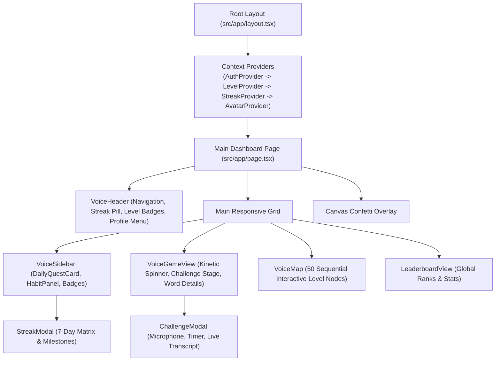
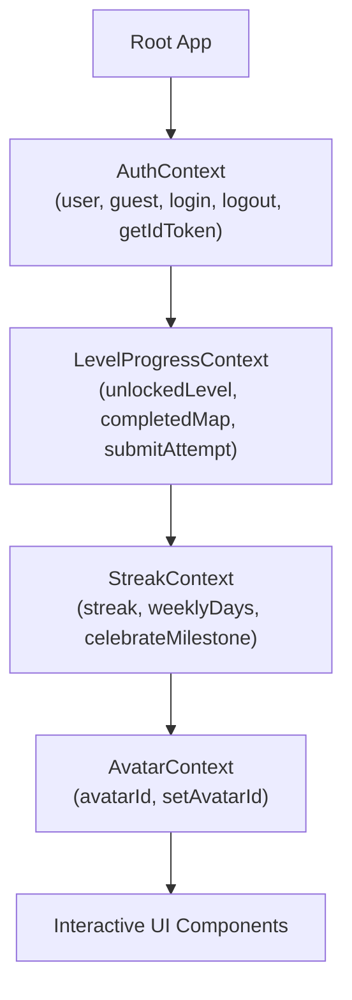

# Chapter 08: Frontend Engineering & UI/UX

> **Navigation:** [Index](file:///c:/Users/naaza/OneDrive/Desktop/voice/doc/00_master_index_and_syllabus.md) | Previous: [Chapter 07](file:///c:/Users/naaza/OneDrive/Desktop/voice/doc/07_habit_formation_and_streak_system.md) | Next: [Chapter 09: Complete API Route Catalog](file:///c:/Users/naaza/OneDrive/Desktop/voice/doc/09_api_routes_and_backend_architecture.md)

---

## 1. Frontend Design Philosophy: The Tactile Game Interface

Educational applications often feel clinical, dry, or utilitarian. **VOICE** is intentionally engineered with a **Tactile Game Aesthetic**:
* **Physicality:** Buttons have visual depth, drop shadows, and sink downwards on click (`active:translate-y-0.5`).
* **Glassmorphism:** Translucent panels (`backdrop-blur-md`) blur colorful background radial gradients.
* **Micro-Interactions:** Microphones pulse with simulated sound waves, timers change colors as they expire, and cards bounce into view with spring physics.

```
+-----------------------------------------------------------------------------------+
|                            APPLICATION DASHBOARD (DESKTOP)                        |
+-----------------------------------------------------------------------------------+
| [VOICE Brand]   [🔥 7d Streak]   [⭐ 24 Stars]   [Level 4/50]   [Avatar Customizer]|
+-----------------------------------------------------------------------------------+
|  LEFT PANEL (Voice Habit)     |  CENTER STAGE (VoiceMap & Game View)              |
|  - Daily Quest Card           |  - 3D Kinetic Word Spinner                        |
|  - 7-Day Monday-Sunday Matrix |  - Target Prompt & Guiding Questions              |
|  - Scholar Badges Shelf       |  - Real-time Audio Wave & Speech Output           |
|                               |  - [Start Challenge] [Listen to Accent]           |
+-----------------------------------------------------------------------------------+
|  RIGHT PANEL (Scholar Leaderboard)                                                |
|  - Top 10 Global Speakers (Rank, XP, Level, Avatar)                               |
+-----------------------------------------------------------------------------------+
```

---

## 2. Component Hierarchy & Atomic Architecture

VOICE organizes its UI components using an adapted **Atomic Design** structure:



---

## 3. Styling with Tailwind CSS 4 & Glassmorphism

VOICE utilizes **Tailwind CSS 4** for styling. The core visual container is `GlassPanel.tsx`:

```tsx
// From src/components/ui/GlassPanel.tsx
import React from "react";
import clsx from "clsx";

interface GlassPanelProps extends React.HTMLAttributes<HTMLDivElement> {
  children: React.ReactNode;
  className?: string;
  intensity?: "light" | "medium" | "heavy";
}

export function GlassPanel({
  children,
  className,
  intensity = "medium",
  ...props
}: GlassPanelProps) {
  const intensityStyles = {
    light: "bg-white/40 backdrop-blur-sm border-white/40 shadow-sm",
    medium: "bg-white/70 backdrop-blur-md border-white/60 shadow-md",
    heavy: "bg-white/90 backdrop-blur-lg border-white/80 shadow-xl",
  };

  return (
    <div
      className={clsx(
        "rounded-2xl border transition-all duration-200",
        intensityStyles[intensity],
        className
      )}
      {...props}
    >
      {children}
    </div>
  );
}
```

### The 3D Tactile Button (`src/components/ui/TactileButton.tsx`)
Rather than a flat, lifeless rectangular button, `TactileButton` emulates a physical arcade button:

```tsx
// Key visual classes:
// 1. Bottom shadow gives 3D elevation: shadow-[0_4px_0_0_#2563eb]
// 2. Click event drops button down: active:translate-y-1 active:shadow-none
<button
  className="relative inline-flex items-center justify-center font-bold px-6 py-3 
             rounded-xl text-white bg-blue-500 shadow-[0_4px_0_0_#1d4ed8] 
             transition-all duration-75 active:translate-y-1 active:shadow-none"
>
  Start Speaking
</button>
```

---

## 4. Animation Physics with Framer Motion

Transitions in VOICE use **Spring Physics** rather than linear easing. Spring physics mimic the real world by incorporating mass, stiffness, and damping:

```tsx
// Example from ChallengeModal.tsx
import { motion, AnimatePresence } from "framer-motion";

export function ChallengeModal({ isOpen, onClose }: { isOpen: boolean; onClose: () => void }) {
  return (
    <AnimatePresence>
      {isOpen && (
        <motion.div
          className="fixed inset-0 z-50 flex items-center justify-center bg-black/50 backdrop-blur-sm"
          initial={{ opacity: 0 }}
          animate={{ opacity: 1 }}
          exit={{ opacity: 0 }}
        >
          <motion.div
            className="w-full max-w-lg bg-white rounded-3xl p-6 shadow-2xl"
            initial={{ scale: 0.8, opacity: 0, y: 30 }}
            animate={{ scale: 1, opacity: 1, y: 0 }}
            exit={{ scale: 0.8, opacity: 0, y: 30 }}
            transition={{ type: "spring", stiffness: 350, damping: 25 }}
          >
            {/* Modal Body */}
          </motion.div>
        </motion.div>
      )}
    </AnimatePresence>
  );
}
```

---

## 5. React 19 State Management & Context Architecture

VOICE uses React 19's Context API to deliver a reactive, predictable state tree without the boilerplate of heavy state libraries (Redux or MobX):



### Context Breakdown:
1. **`AuthContext.tsx` (`src/context/AuthContext.tsx`):**
   - Tracks whether the user is logged in via Firebase (`firebaseUser`) or operating in guest mode (`guestUser`).
   - Listens to Firebase's `onAuthStateChanged` stream.
   - Handles automatic route redirection.
2. **`LevelProgressContext.tsx` (`src/context/LevelProgressContext.tsx`):**
   - Keeps track of the highest level unlocked ($1 \dots 50$).
   - Provides a `refreshLevels()` trigger to fetch progress after an attempt.
3. **`StreakContext.tsx` (`src/context/StreakContext.tsx`):**
   - Stores current streak number and longest historical streak.
   - Renders the Monday-to-Sunday weekly indicator.
   - Controls visibility of `StreakCelebrationModal`.
4. **`AvatarContext.tsx` (`src/context/AvatarContext.tsx`):**
   - Manages active avatar identity (`avatar-01` through `avatar-12`).

---

## 6. How Students Can Implement Tactile UI in Their Projects

Students can achieve high-end UI design by following three practical rules:
1. **Never use pure black or pure grey borders:** Use tinted translucent borders (e.g., `border-blue-200/50` or `border-white/40`) to create a polished, glass effect.
2. **Add click feedback to every interactive element:** Always pair `hover:scale-105` with `active:scale-95` on clickable cards.
3. **Use Confetti sparingly for celebratory punctuation:**
   ```typescript
   import confetti from "canvas-confetti";
   
   export function fireVictoryConfetti() {
     confetti({
       particleCount: 100,
       spread: 70,
       origin: { y: 0.6 },
     });
   }
   ```

---

## 7. Student Practice Labs

1. **Lab 8.1:** Add Dark Mode support using Tailwind's `dark:` classes and a dark mode toggle button in `VoiceHeader.tsx`.
2. **Lab 8.2:** Create a custom sound effect utility that plays an audio chime (using HTML5 `Audio`) whenever a level is completed.
3. **Lab 8.3:** Implement a responsive mobile bottom navigation drawer for small screens (< 768px).

---

*Continue to [Chapter 09: Complete API Route Catalog](file:///c:/Users/naaza/OneDrive/Desktop/voice/doc/09_api_routes_and_backend_architecture.md) for detailed documentation of all REST backend endpoints.*
